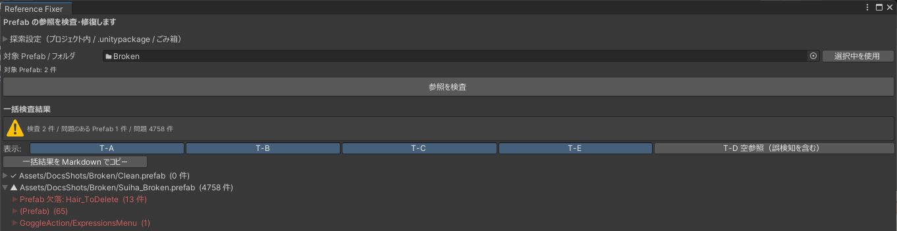

# まとめて検査

複数の Prefab やフォルダを一度に検査できます。まとめてできるのは検査だけで、修復は 1 件ずつです。

## 使い方

1. Project ウィンドウで Prefab を複数選ぶか、フォルダを選びます。
2. 「選択中を使用」を押します。対象の欄の下に「対象 Prefab: 件数」が出ます。
3. 「参照を検査」を押し、件数の確認ダイアログで続けます。

途中でキャンセルすると、そこまでの結果を表示します。

## 結果

先頭に「検査 件数 / 問題のある Prefab 件数 / 問題 件数」が出て、その下に Prefab ごとの結果が並びます。

{ .shot loading=lazy }

| 記号 | 内容 |
|---|---|
| `✓` | 問題なし |
| `▲` | 問題あり。最初から開いています |

各項目の読み方は[結果の読み方](results.md)と同じです。「候補を探す」から修復もできます。修復すると、その Prefab だけを検査し直して結果を更新します。

「一括結果を Markdown でコピー」で、すべての結果を 1 つの Markdown としてコピーできます。

検査の記録は、1 回につき `RefFixer_Backup/日時/batch-inspection.md` に書き出されます。

Prefab の数が多いと時間がかかります。最初はアバター 1 体分のフォルダなどで試してください。
