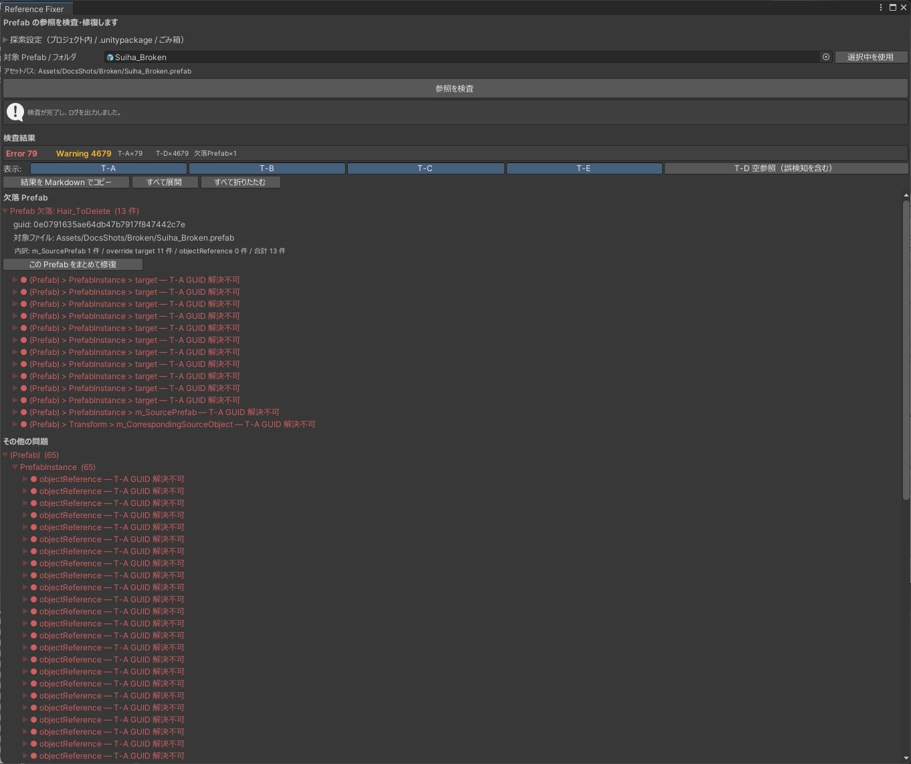

# はじめに

Poyo's Reference Fixer は、Prefab の参照切れ（Missing）を調べて直す Unity エディタ拡張です。参照がどの GUID を指していたかを Prefab のファイルから読み取り、プロジェクト・`.unitypackage`・OS のごみ箱から元のアセットを探します。

{ .shot loading=lazy }

## できること

- Prefab の参照切れを見つけ、原因ごとに分類する
- 壊れた参照が指していた GUID と、ファイルの行番号を表示する
- つなぎ直す候補を、プロジェクト内・`.unitypackage`・ごみ箱から探す
- 選んだ候補で参照を書き換える
- 複数の Prefab やフォルダをまとめて検査する

## 修復について

修復では `.prefab` ファイルを書き換えます。

- 書き換えるのは、候補を選んで修復のボタンを押し、確認ダイアログで承認したときだけです。自動では直しません。
- 書き換える前に、元のファイルを `RefFixer_Backup/` にコピーします（[バックアップとログ](backup.md)）。
- 修復は 1 件ずつです。まとめてできるのは検査だけです。

候補には「確実な復元」か「推測」のどちらかが付きます。

| 表示 | 意味 |
|---|---|
| 確実な復元 | 壊れた参照の GUID と、候補の GUID が一致しています。参照が指していたアセットそのものです |
| 推測 | 名前が似ているなどの理由で選んだ候補です。別のアセットのことがあるので、中身を確かめてから使ってください |

元のアセットがどこにも残っていないときは直せません。配布元から入手し直してください。

## 動作の前提

- プロジェクトの Asset Serialization が Force Text であること（[Force Text への変換](serialization.md)）
- Unity 2022.3
- エディタ専用です。外部と通信しません。
