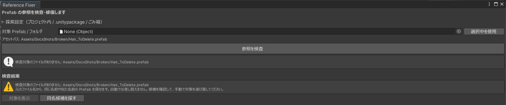

# 検査

検査では Prefab を読むだけで、書き換えません。

## 対象を指定する

「対象 Prefab / フォルダ」に、検査する `.prefab` かフォルダを指定します。

- Project ウィンドウで選んでから「選択中を使用」を押すか、欄にドラッグ＆ドロップします。
- フォルダを指定すると、その中の Prefab がすべて対象になります。
- 対象が 2 件以上のときは[まとめて検査](batch.md)になります。

指定したものに Prefab が 1 つも無いときは「指定した対象に Prefab がありません。」と出ます。

## 検査する

「参照を検査」を押します。

指定した Prefab が Prefab Variant のときは親の Prefab も、中に別の Prefab が入っているときはその Prefab も検査します。そのため、結果に指定していないファイルが出ることがあります。

Prefab のファイルの中で、次の参照を調べます。

| 参照 | 場所 |
|---|---|
| 通常の参照 | コンポーネントのフィールド（Mesh、Material、Transform など） |
| override の参照 | Prefab インスタンスで変更した値 |
| 親 Prefab の参照 | Prefab Variant の親、入れ子の Prefab |
| スクリプトの参照 | コンポーネントのスクリプト。ここが壊れると Missing Script になります |

検査するたびに、記録が `RefFixer_Backup/日時/inspection.md` に書き出されます（[バックアップとログ](backup.md)）。

## 対象のファイルが無いとき

指定した Prefab のファイルそのものが無いときは、「検査対象のファイルがありません」と出ます。

{ .shot loading=lazy }

「同名候補を探す」を押すと、元のファイル名から同じ名前や似た名前の Prefab を探して表示します。候補はすべて推測で、自動では差し替えません。正しいものを見つけたら、対象に指定し直して検査してください。
