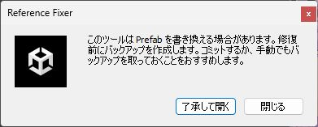
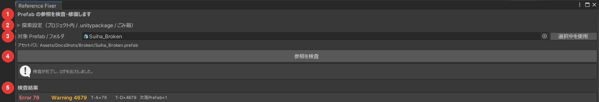

# インストール

## 動作環境

| 項目 | 要件 |
|---|---|
| Unity | 2022.3 |
| Asset Serialization | Force Text（[Force Text への変換](serialization.md)） |
| VRChat SDK | 不要です |
| ごみ箱の探索 | Windows の標準のごみ箱。macOS・Linux 用の処理もありますが、実機では確かめていません |

## VCC / ALCOM から入れる

1. VCC または ALCOM に `https://vpm.maaaaa.net/index.json` を追加します。
2. プロジェクトの Manage Packages を開き、「Poyo's Reference Fixer」を追加します。

## .unitypackage から入れる

[リリースページ](https://github.com/Poyotoron/Ref-Fixer/releases)から `.unitypackage` をダウンロードし、Unity にドラッグ＆ドロップしてインポートします。

## 開き方

メニューの `Tools > Poyo's Reference Fixer` でウィンドウが開きます。初めて開くときは確認ダイアログが出るので、「了承して開く」を押します。次からは出ません。

{ .shot loading=lazy }

ウィンドウには上から次のものが並びます。

{ .shot loading=lazy }

| 番号 | 部分 | 内容 |
|---|---|---|
| 1 | 上部 | Force Text になっていないときは、ここに警告と変換ボタンが出ます |
| 2 | 探索設定 | 探索モードの切り替え、`.unitypackage` のフォルダの登録、ごみ箱を調べ直す |
| 3 | 対象 Prefab / フォルダ | 検査する Prefab かフォルダを指定します |
| 4 | 参照を検査 | 検査を始めます |
| 5 | 検査結果 | 見つかった問題が並びます。ここから候補を探して修復します |

## 保存されるもの

| 内容 | 場所 |
|---|---|
| 探索モードの設定、登録した `.unitypackage` のフォルダ | `Assets/zzz_pytr/Ref-Fixer/Settings.asset` |
| `.unitypackage` の索引 | `Library/RefFixer/unitypackage-index.json` |
| バックアップとログ | プロジェクト直下の `RefFixer_Backup/` |

索引は `Library/` の中にあるため、`Library/` を削除すると消えます。登録したフォルダは残るので、「索引を構築 / 更新」を押せば作り直せます。

## アンインストール

VCC / ALCOM の Manage Packages で削除します。`Assets/zzz_pytr/Ref-Fixer/` と `RefFixer_Backup/` は残るので、不要なら削除してください。

`RefFixer_Backup/` には、修復する前の `.prefab` のコピーが入っています。修復した結果を確かめ終わるまでは消さないでください。
