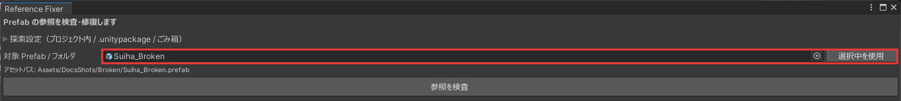
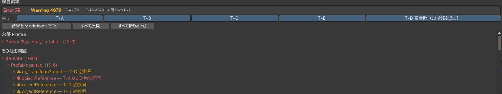
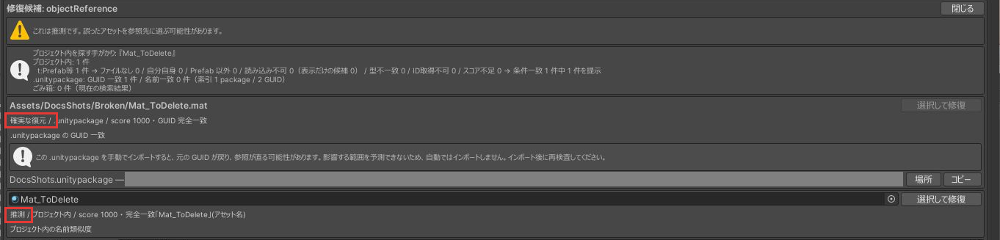

# クイックスタート

壊れた Prefab を 1 つ検査し、候補を選んで直すまでの手順です。

## 1. 対象を指定する

`Tools > Poyo's Reference Fixer` でウィンドウを開きます。上部に警告が出て「参照を検査」が押せないときは、先に [Force Text への変換](serialization.md)をしてください。

Project ウィンドウで壊れた `.prefab` を選び、「選択中を使用」を押します。「対象 Prefab / フォルダ」の欄にドラッグ＆ドロップしてもかまいません。

{ .shot loading=lazy }

## 2. 検査する

「参照を検査」を押します。検査では Prefab は書き換わりません。

問題があると、件数と一覧が出ます。赤い `●` は Error、黄色い `▲` は Warning です。分類の意味は[結果の読み方](results.md)にあります。

{ .shot loading=lazy }

## 3. 候補を探す

直したい項目を開いて「候補を探す」を押すと、修復候補のパネルが開きます。

{ .shot loading=lazy }

候補には「確実な復元」か「推測」が付いています。推測の候補は、別のアセットのことがあります。

候補が出ないときは、[.unitypackage の索引](search-unitypackage.md)を作るか、[ごみ箱](search-trash.md)を調べてから、もう一度探してください。

## 4. 修復する

使う候補の「選択して修復」を押します。元のファイルを `RefFixer_Backup/` にコピーしてから、確認ダイアログが出ます。書き換わる内容を確かめて承認すると、書き換えたあとに再インポートと再検査が自動で行われます。

確認ダイアログの読み方は[修復](repair.md)にあります。直した結果がおかしいときは、[バックアップから戻せます](backup.md#restore)。
