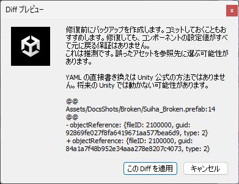
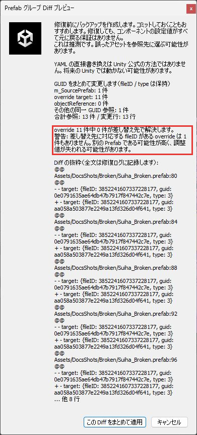

# 修復

修復では `.prefab` ファイルを書き換えます。このツールでファイルを書き換えるのは修復だけです。

## 修復の流れ

1. 元の `.prefab` を `RefFixer_Backup/日時/` にコピーします。
2. 書き換える内容を確認ダイアログに出します。
3. 承認すると書き換えます。キャンセルしたときは書き換えません。バックアップは残ります。
4. 再インポートと再検査を自動で行い、結果を更新します。

## 書き換えのしかた

ツールが自動で選びます。

| しかた | 使う場面 |
|---|---|
| Unity の API で値を入れる | コンポーネントの通常のフィールド |
| YAML を直接書き換える | 親 Prefab の参照、override の参照、Missing Script など、API で値を入れられない場合 |

YAML を直接書き換えるときは、書き換える行を Diff で表示します。書き換えるのはその行だけで、改行コードや文字コードは変えません。

{ .shot loading=lazy }

YAML の直接の書き換えは、Unity が用意している方法ではありません。今後の Unity で使えなくなることがあります。

## 欠落 Prefab をまとめて修復する { #group }

Prefab が丸ごと欠落しているときは、同じ GUID がファイルの中の何十か所にも書かれています。[欠落 Prefab](results.md#missing-prefab) のまとめにある「この Prefab をまとめて修復」で、これらをまとめて書き換えます。

書き換えるのは GUID だけで、fileID と type はそのままです。同じ GUID を参照しているほかのファイルは書き換えません。ほかのファイルは、それぞれ検査して直してください。

確認ダイアログには、差し替え先が元の Prefab と同じものかどうかの目安が出ます。

{ .shot loading=lazy }

| 表示 | 内容 |
|---|---|
| すべての override の fileID が差し替え先にあります | 同じ Prefab の可能性が高い候補です |
| 差し替え先に対応する fileID がない override があります | 一部の override の値が失われることがあります |
| 差し替え先に対応する fileID がある override は 1 件もありません | 別の Prefab の可能性が高い候補です。override で変えた見た目の調整がすべて失われることがあります |

「差し替え先に対応する fileID がある override は 1 件もありません」と出たときは、候補を選び直してください。

確認ダイアログには Diff の先頭だけが出ます。すべての Diff は `repair.md` に記録します（[バックアップとログ](backup.md)）。

## Missing Script を直す

Missing Script の候補は、スクリプトの名前と、ファイルに残っているフィールドの構成が合うかどうかで選びます。「残存フィールド 7/9 一致」のように理由が出ます。候補はすべて推測です。

!!! warning
    スクリプトを差し替えると、Unity はコンポーネントを新しいスクリプトとして読み直します。ファイルに残っている設定値が読み込まれることもありますが、このツールでは確かめていません。設定値が失われることがあるので、バックアップを取ってあることと Diff の内容を確かめてから承認してください。

## 修復できないとき

次のメッセージが出たときは、何も書き換えていません。

| メッセージ | 対処 |
|---|---|
| 対象 Prefab が Prefab Mode で開かれています | その Prefab を閉じてから、もう一度修復します |
| 検査時の参照位置が現在のファイルと一致しません | 検査のあとにファイルが変わっています。検査し直してください |
| 差し替え先のファイルがありません | 候補のファイルがありません。検査し直してください |

## 修復したあと

まとめて修復したあとに「再検査後も同じ Prefab グループの問題が残っています」と出たときは、差し替え先が別の Prefab だったか、一部の参照が直らなかったということです。結果を確かめ、必要なら[バックアップから戻して](backup.md#restore)ください。
