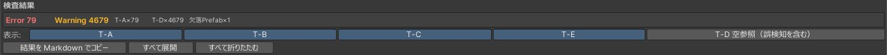
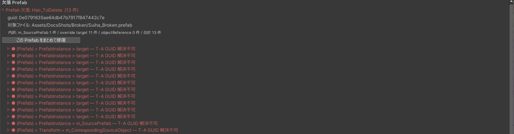

# 結果の読み方

## 件数と表示の切り替え

結果の先頭に、Error と Warning の件数、分類ごとの件数、欠落している Prefab の数が出ます。その下のボタンで、分類ごとに表示を切り替えられます。

{ .shot loading=lazy }

| 記号 | 深刻度 | 意味 |
|---|---|---|
| 赤い `●` | Error | 参照先が見つかりません |
| 黄色い `▲` | Warning | 壊れている可能性があります。問題の無いものや、Unity が自動で補うものも含みます |

## 分類

| 分類 | 状態 | 主な原因 |
|---|---|---|
| T-A GUID 解決不可 | 参照している GUID のアセットがプロジェクトにありません | 必要なパッケージやアセットが入っていない、`.meta` を作り直して GUID が変わった、アセットを消した |
| T-B fileID 解決不可 | GUID のアセットはあるが、その中のオブジェクトが見つかりません（Warning） | FBX を再インポートして、中の Mesh や AnimationClip が変わった |
| T-B 参照先のファイルがありません | Unity の記録には GUID が残っているが、ファイルそのものがありません（Error） | ファイルが消えた |
| T-C Missing Script | コンポーネントのスクリプトが見つかりません | スクリプトを含むパッケージを外した |
| T-D 空参照 | 参照が空です | ほとんどは何も入れていないだけのフィールドです |
| T-E 型不一致 | 参照先はあるが、フィールドが求める型と違います | GUID を手で書き換えた |

T-D は既定で表示しません。「T-D 空参照（誤検知を含む）」のボタンで表示できます。ほかの手がかりが無いときだけ見てください。

## 欠落 Prefab { #missing-prefab }

Prefab が丸ごと見つからないとき、1 つの Prefab の欠落が数十件の参照エラーになって出ます。このような項目は、GUID ごとに「Prefab 欠落: 名前（件数）」として 1 つにまとめて表示します。

{ .shot loading=lazy }

| 表示 | 内容 |
|---|---|
| guid | 壊れた参照が指している GUID です |
| 対象ファイル | どの Prefab の中の参照かです |
| 内訳 | 親 Prefab の参照、override の参照、通常の参照の件数です |
| 元パス | 元の場所が分かったときに出ます |

名前が分からないときは「名前不明」と出ます。`.unitypackage` の索引やごみ箱から名前が分かることがあります。

まとめの中の項目は、まとめの「この Prefab をまとめて修復」で直します（[欠落 Prefab をまとめて修復する](repair.md#group)）。

## 項目を開く

各項目を開くと、次のものが出ます。

- 壊れた参照の `guid` と `fileID`
- ファイルのパスと行番号
- 「対象を表示」：Prefab を開き、該当する GameObject を選択します
- 「候補を探す」：修復候補のパネルを開きます

## 結果をコピーする

「結果を Markdown でコピー」を押すと、結果を Markdown の表でコピーします。アセットのパスと名前が入るので、人に見せるときは中身を確かめてください。
