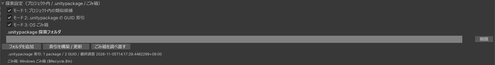

# プロジェクト内から探す

探索設定の「モード 1: プロジェクト内の類似候補」です。壊れた参照の手がかりになる名前を集め、プロジェクトの中から同じ種類で名前の近いアセットを探します。準備は要りません。

{ .shot loading=lazy }

## 手がかりにする名前

上にあるものから順に使います。

| 手がかり | 使えるとき |
|---|---|
| `.unitypackage` の索引に記録された元のパス | [索引](search-unitypackage.md)を作ってあるとき |
| ごみ箱にある、同じ GUID のファイルの名前 | [ごみ箱](search-trash.md)を調べてあるとき |
| Prefab のファイルに残っているパスや名前 | 壊れ方によって残っています |
| 参照している GameObject の名前 | ほかに手がかりが無いとき |

名前が分からないと、このモードでは候補が出ません。先に索引を作るか、ごみ箱を調べると、名前が分かることがあります。

## 候補の表示

候補には、選んだ理由が表示されます。

```
推測 / プロジェクト内 / score 800 ・ 前方一致「Hoodie_A」(ファイル名)
```

| 一致のしかた | 内容 |
|---|---|
| 完全一致 | 名前が同じです |
| 拡張子違いの一致、前方一致 | 一方の名前が、もう一方の名前で始まります |
| 部分一致 | 一方の名前が、もう一方の名前を含みます |
| 編集距離 | 数文字だけ違います |

このモードの候補は、名前が完全に一致していてもすべて推測です。GUID が違うので、別のファイルです。`Body` や `Material` のような名前は、同じ名前で中身の違うものがよくあります。修復する前に、候補の中身を Inspector で確かめてください。

- 候補は最大 8 件です。名前の一致が弱いものは出しません。
- ほかのモードで確実な候補が見つかっていれば、そちらが上に並びます。

## 候補の Prefab も壊れているとき

候補の Prefab 自体も読み込めないときは、「名前は一致しますが、この Prefab 自身も読み込めません」と出て、修復できません。先にその Prefab を検査して直してください。

## 手動で指定する

修復候補のパネルの下にある「手動指定（推測）」に、正しいアセットをドラッグし、「手動指定した候補で修復」を押します。手動で指定したものも推測として扱い、バックアップと確認ダイアログの手順は同じです。Missing Script のときは MonoScript だけを指定できます。

## 探索の内訳

修復候補のパネルには、探索で何を調べたかが出ます。

```
プロジェクト内を探す手がかり: 『Hoodie』
プロジェクト内: 3 件
  t:Prefab等 812 件 → ファイルなし 4 / 自分自身 1 / … → 条件一致 5 件中 3 件を提示
```

候補が 0 件のときは、ここで理由を確かめられます。
