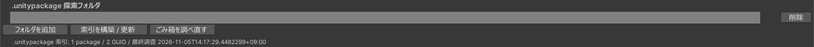

# .unitypackage から探す

探索設定の「モード 2: .unitypackage の GUID 索引」です。BOOTH などで入手した `.unitypackage` のフォルダを登録すると、壊れた参照の GUID がどの `.unitypackage` に入っていたかが分かります。

`.unitypackage` の中には、アセットの GUID と元のパスが入っています。壊れた参照の GUID と同じものが見つかれば、その `.unitypackage` のそのファイルが、参照の指していたアセットです。

## 索引を作る { #build-index }

1. 「探索設定」を開きます。
2. 「フォルダを追加」で、`.unitypackage` を置いているフォルダを選びます。複数登録でき、サブフォルダも調べます。
3. 「索引を構築 / 更新」を押し、確認ダイアログで続けます。

{ .shot loading=lazy }

初めて作るときは、`.unitypackage` をすべて読むため、数が多いと数分から数十分かかります。途中でキャンセルでき、そこまでに読んだ分は保存されます。

2 回目からは、サイズと更新日時が変わっていない `.unitypackage` を読み飛ばします。`.unitypackage` を増やしたら、もう一度「索引を構築 / 更新」を押してください。

## 候補の種類

### GUID 一致（確実な復元）

```
確実な復元 / .unitypackage / score 1000・GUID 完全一致
```

その `.unitypackage` に、参照が指していたアセットが入っています。インポートすると、元の GUID のアセットが戻ります。

### 名前一致（推測）

GUID が索引に無いときは、名前で探します。`.meta` を作り直して GUID が変わった場合などに見つかります。

```
推測 / .unitypackage / 部分一致「Hoodie」
```

名前一致の `.unitypackage` は、インポートしただけでは参照が直りません。GUID が違うためです。インポートしたあとに検査し直し、[プロジェクト内の候補](search-project.md)として選んでください。

多くの `.unitypackage` に含まれるありふれた名前は、候補に出しません。

## インポートは自分でする

このツールは `.unitypackage` をインポートしません。インポートで何が追加・上書きされるかは中身しだいで、ツールからは分からないためです。

候補には `.unitypackage` のパスが出ます。「場所」でエクスプローラーを開き、「コピー」でパスをコピーできます。インポートしたら、もう一度「参照を検査」を押してください。

## 索引の保存先

索引は `Library/RefFixer/unitypackage-index.json` に保存します。`Library/` を削除すると消えますが、登録したフォルダは残るので、「索引を構築 / 更新」で作り直せます。

索引に記録された元のパスは、[プロジェクト内の探索](search-project.md)の手がかりにも使います。名前が分からなかった欠落 Prefab の名前が、索引から分かることがあります。
